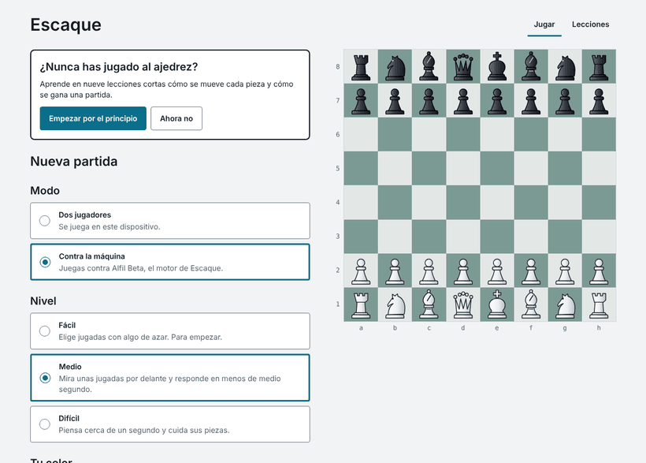

# Escaque

*Escaque, by CalvarioTechLabs.* Producto diseñado y programado por [CalvarioTechLabs](https://calvariotechlabs.com/).

**[Jugar ahora: escaque.calvariotechlabs.com](https://escaque.calvariotechlabs.com)** (sin registro, sin instalar nada; se puede instalar como app y juega sin conexión).



*Una partida contra la máquina con el coach explicando un error, y el repaso de una partida cargada por PGN con la curva de evaluación y los errores clave.*

App web para aprender ajedrez con motor propio (**Alfil Beta**), escrita desde cero en TypeScript sin dependencias en ejecución: ni librerías de ajedrez, ni frameworks de interfaz. TypeScript solo se usa para compilar.

**Qué hay dentro:** reglas completas verificadas con perft, un motor con tres niveles que corre en un Web Worker, un coach que explica por qué una jugada fue mala, 15 lecciones guiadas, repaso de la partida con curva de evaluación, importación y exportación de PGN, y PWA. Se juega entero con teclado y todo lleva etiquetas para lectores de pantalla (probado en el árbol de accesibilidad; falta probarlo con un lector real). [Cifras](#cifras), [fuerza del motor](#fuerza-del-motor), [decisiones técnicas](#decisiones-técnicas), [auditorías externas](#auditorías-externas), [capacidades verificadas y limitaciones conocidas](#capacidades-verificadas-y-limitaciones-conocidas) y [qué aprendí](#qué-aprendí-y-qué-haría-distinto) más abajo.

## Estado

Los seis hitos están hechos, más el repaso de la partida y el PGN. Alfil Beta juega con tres niveles en un Web Worker, el coach explica los errores y hay 15 lecciones guiadas. La web se instala como app (PWA) y se publica como sitio estático en Vercel. La demo está detrás de un desafío anti-bots de Vercel: la primera visita puede tardar un instante.

**Release Candidate (24 de noviembre de 2026).** Tras las dos [auditorías externas](#auditorías-externas) se está cerrando una primera versión estable: coach coherente (B1), banco de posiciones contra Stockfish (B2), análisis del coach (B3), pruebas de regresión (B4), firma de CalvarioTechLabs (B5, B7), validación integral (B6) y esta documentación viva (B9). La afinación del motor (B11) y el informe de la RC (B10) van en sus propias PR. Lo que todavía no está resuelto está en [limitaciones conocidas](#capacidades-verificadas-y-limitaciones-conocidas).

| Hito | Descripción | Estado |
| --- | --- | --- |
| 0 | Repositorio, estructura y herramientas | Hecho |
| 1 | Reglas completas + perft | Hecho |
| 2 | Tablero jugable (dos jugadores) | Hecho |
| 3 | Máquina en Web Worker, 3 niveles | Hecho |
| 4 | Coach: explicación de errores | Hecho |
| 5 | Lecciones guiadas (ampliadas después del hito; ver [Cifras](#cifras)) | Hecho |
| 6 | Pulido para portfolio, CI y despliegue | Hecho (este README, CI en GitHub Actions, Vercel) |

## Cifras

Las cifras de la primera tabla **las genera `npm run metrics`** a partir del propio repositorio (se cuentan las pruebas, las lecciones, las dependencias y los ficheros del sitio, y se leen los resultados guardados del banco de posiciones) y la CI falla si el README o [`docs/metricas.json`](docs/metricas.json) no coinciden con lo medido (`npm run metrics:check`). Eso es a propósito: quien añada una prueba, una lección o un fichero al sitio, o regenere el banco, ejecuta `npm run metrics` y confirma el README y el JSON regenerados. Las que dependen del equipo llevan su fecha y su comando, y no las vuelve a medir la CI.

<!-- metricas:inicio (generado por `npm run metrics`; no editar a mano) -->

Generado el 2026-11-24 sobre el commit `b93990f3f1f4` con `npm run metrics` (datos en [`docs/metricas.json`](docs/metricas.json)).

| Qué | Cifra | Cómo se comprueba |
| --- | --- | --- |
| Dependencias en ejecución | **0** (la única devDependency es typescript, solo para compilar) | CI (trabajo `dependencias`) y `tools/metricas.test.mjs` |
| Pruebas funcionales | **1.119** pruebas en 204 suites (`node --test`, sin las de reloj ni el perft completo) | `npm test`; `npm run metrics:check` en la CI |
| Lecciones guiadas | **15**: 9 de primeros pasos y 6 de tácticas | Datos en `src/lessons`; `npm run metrics:check` |
| Posiciones de referencia de perft | **21**, todas exactas (la inicial, Kiwipete, las posiciones 3 a 6 de la Chess Programming Wiki y las «trampa» de Sedlak) | `npm run test:perft` en la CI |
| Sitio publicado | 92 ficheros, 779 KB en disco; JS + CSS + HTML suman 180 KB comprimidos con gzip (cada fichero por separado) | `npm run metrics:check` (margen del 5 %) |
| Banco de 82 posiciones (`despues-b3`) | Alfil Beta Difícil: mejor jugada de la referencia en 46 de 82 y equivalente (a menos de 30 cp) en 67; 4 errores de más de 2 peones en tácticas; mantiene 18 de 18 mates. Coach: veredicto igual al de la referencia en 99 de 152 informes (65 %), detecta 20 de 23 errores graves, 5 falsos positivos en 123 jugadas equivalentes y 0 informes con contradicciones | `bench/resultados/despues-b3.json` (2026-11-24, commit `7ab25d970e05`); metodología en `bench/README.md` |
| Tiempo del banco (depende del equipo) | Difícil: 749 ms de media y 907 ms como máximo. Coach: 290 ms de media, 1.046 ms el percentil 95 y 3.781 ms como máximo | Registrado en el mismo fichero; no lo vuelve a medir la CI |
| Pruebas de extremo a extremo | **97** en 14 ficheros, con Chrome real (teclado, ARIA, SAN, arrastre, PGN, instalación) | CI (trabajo `accesibilidad`) en cada PR; el recuento se registra con `npm run metrics -- --e2e` (2026-11-24) |
| Velocidad de perft (depende del equipo) | 5,3 millones de nodos por segundo (inicial, profundidad 5: 4.865.609 nodos; Node v22.23.5, 4 núcleos) | Registrado con `npm run metrics -- --rendimiento` (2026-11-24); no lo comprueba la CI |

<!-- metricas:fin -->

### Mediciones puntuales

Medidas a mano en un contenedor cloud de 4 núcleos con Node 22 durante el hito 6, **antes** de la firma de CalvarioTechLabs y de la afinación del motor (B11). No las comprueba ninguna prueba: léelas como una fotografía con fecha, no como una garantía. En un portátil moderno salen mejor, así que son un suelo, no un techo.

| Qué | Cifra |
| --- | --- |
| Perft profundo | `npm run perft` llega más lejos que los tests: 119.060.324 nodos desde la inicial a profundidad 6 en 18,8 s y 193.690.690 en Kiwipete a profundidad 5 en 30 s |
| Tabla de transposición | A la misma profundidad, Alfil Beta visita un **97 % menos de nodos** con la tabla que sin ella en las cinco posiciones de `npm run bench` (1,45 millones frente a 57,5 millones) y tarda 7,9 s en vez de 126 s. Va del −31 % en Kiwipete al −99,9 % en el final de peones Fine 70 (detalle más abajo) |
| Partidas entre niveles | Difícil gana 20 de 20 al azar, a Fácil y a Medio; Medio gana 20 de 20 a Fácil (detalle en [Fuerza del motor](#fuerza-del-motor)) |
| Lighthouse 12.8.2 (sitio servido en local, Chrome 153) | Escritorio: rendimiento **99**, accesibilidad **100**, buenas prácticas **100**, SEO 91 (FCP 0,5 s, LCP 0,8 s, TBT 0 ms, CLS 0). Móvil con la ralentización simulada de Lighthouse: rendimiento **86**, accesibilidad **100**, buenas prácticas **100**, SEO 91 (FCP 2,0 s, LCP 3,9 s, TBT 0 ms, CLS 0). El SEO pierde 9 puntos por no tener `robots.txt`; es a propósito, no busca público. Se mide a mano con `npx lighthouse@12.8.2`, no es una dependencia ni corre en la CI |
| Cabeceras de seguridad | CSP sin `unsafe-inline`, `X-Frame-Options: DENY`, `nosniff`, `Referrer-Policy`, `Permissions-Policy` y `COOP`, comprobadas por tests sobre `vercel.json`. **No están medidas en las páginas HTML de producción** (ver [limitaciones](#capacidades-verificadas-y-limitaciones-conocidas)) |
| Accesibilidad | Las pruebas de extremo a extremo juegan una partida entera solo con teclado, comprueban la rejilla ARIA de 64 casillas etiquetadas, que todo control tiene nombre, que cada jugada se anuncia en SAN española («Negras: Dh4#. Dama de d8 a h4. Jaque mate.») y que el repaso se maneja con ← → Inicio y Fin. **No se ha probado con un lector de pantalla real** |

## Fuerza del motor

**No hay un Elo medido, y no voy a inventarme uno.** Para ponerle un Elo hace falta jugar contra rivales de fuerza conocida, y Alfil Beta solo se ha enfrentado a sí mismo y a un jugador al azar. Lo que sí hay son partidas medidas, con colores alternos, un hilo y los tiempos de cada nivel (`npm run match -- 20`, unos 40 minutos; 80 partidas, todas terminadas por jaque mate; el registro completo está en [`docs/media/partidas-niveles.txt`](docs/media/partidas-niveles.txt)):

| Enfrentamiento | Resultado (partidas ganadas, tablas, perdidas) | Qué dice |
| --- | --- | --- |
| Difícil contra jugador al azar | +20 =0 −0 | Gana siempre, como se espera |
| Difícil contra Fácil | +20 =0 −0 | |
| Difícil contra Medio | +20 =0 −0 | |
| Medio contra Fácil | +20 =0 −0 | |

Con 20 victorias de 20, la estadística solo da una cota: con un 95 % de confianza cada nivel puntúa al menos un 86 % contra el de abajo, lo que equivale a **más de 300 puntos Elo de diferencia entre niveles contiguos** (sin techo, porque no hubo ni una tabla). En esta pasada Difícil pensó 845 ms de media y 909 ms como máximo (1.870 jugadas; el banco de [Cifras](#cifras) mide otro conjunto de posiciones, de ahí la diferencia), a profundidad 5 en la apertura y más de 10 en finales de peones.

Estas partidas se jugaron antes de la afinación del motor (B11, issue #63); se repetirán cuando se fusione. Para situarlo sin números inventados: Alfil Beta no usa poda por jugada nula, reducciones de jugadas tardías ni libro de aperturas; es un motor clásico de búsqueda con evaluación de material y tablas por casilla, pensado para enseñar, no para competir. El [banco de posiciones](bench/README.md) ya compara a Alfil Beta con Stockfish 17.1 como referencia externa (solo en desarrollo: no es una dependencia ni entra en el sitio), pero mide si elige buenas jugadas, no cuánto «Elo» tiene. Poner un Elo exigiría partidas contra un rival de fuerza conocida (por ejemplo Stockfish con `UCI_Elo`) y un número de partidas estadísticamente válido; no está hecho.

## Cómo se hizo

El diseño y las decisiones técnicas (arquitectura, tablero 0x88, estrategia de búsqueda, criterios de «terminado») son míos. La implementación está asistida con Claude y revisada por mí. Las decisiones y las cifras de abajo están medidas y documentadas aquí.

## Decisiones técnicas

- **Cero dependencias.** El proyecto es una demostración de oficio: reglas, motor, interfaz, service worker y servidor de desarrollo son propios. Coste: más código; beneficio: nada que actualizar ni auditar, y el sitio publicado pesa unos 75 KB comprimidos.
- **Tablero 0x88, no bitboards.** En JavaScript un bitboard de 64 bits obliga a `BigInt`, que es lento. Con 0x88 la comprobación de «fuera del tablero» es una máscara y las tablas se indexan sin conversiones.
- **Legalidad por aplicar y deshacer.** Se generan todas las jugadas posibles, se aplica cada una y se descarta la que deja al rey en jaque. Es lo más simple de razonar y lo valida el perft contra cifras publicadas.
- **Una sola clave Zobrist** (64 bits en dos mitades de 32, generador propio) para la triple repetición, las repeticiones dentro de la búsqueda y la tabla de transposición.
- **Motor en un Worker, coach en otro.** Pensar no congela la interfaz y revisar tu jugada no retrasa la respuesta de la máquina.
- **Sitio estático sin bundler.** `tsc` emite módulos ES que el navegador carga tal cual. Sin backend, cuentas, analítica ni cookies. Al no haber servidor no hay nonce por petición: la CSP prohíbe `unsafe-inline` y un test comprueba que el sitio no lleva código en línea.
- **Tipografías alojadas, no de un CDN.** Space Grotesk e IBM Plex (licencia SIL OFL, en `public/fonts/` con su `OFL.txt`) se sirven desde el propio dominio: cuatro woff2 con solo el alfabeto latino, unos 75 KB, precargados y guardados por el service worker para jugar sin conexión. La CSP solo admite `font-src 'self'` y nada se pide a terceros.
- **Las lecciones son datos.** Cada una es una FEN, unos pasos y sus motivos de fallo (`src/lessons`); los tests comprueban con el motor que lo aceptado es exactamente lo correcto.
- **Diseño primero.** Ningún cambio visual entra sin pasar por Claude Design y exportarse a `docs/design`.

## CI y despliegue

- **CI** (`.github/workflows/ci.yml`, GitHub Actions, permisos solo de lectura, sin secretos). En cada pull request y en cada push a `main`: tipos con `tsc` estricto, `npm test`, montaje del sitio (`npm run build:site`), perft a profundidad completa (`npm run test:perft`) pruebas de accesibilidad de extremo a extremo (`npm run test:e2e`) y comprobación de que `dependencies` sigue vacío y comprobación de que las cifras de este README siguen al día (`npm run metrics:check`). Aparte corren la cobertura (sin las pruebas de reloj real) y un trabajo de rendimiento con las aserciones de milisegundos, una a una (`npm run test:perf`). Las pruebas de navegador no usan Playwright ni Puppeteer: `tools/cdp.mjs` es un cliente mínimo del protocolo de Chrome (unas 130 líneas, con el `WebSocket` y `fetch` de Node 22) que maneja el Chrome que ya trae el ejecutor de GitHub, con teclado real (`Input.dispatchKeyEvent`).
- **Despliegue.** Vercel publica `site/` desde el repositorio como web estática (`vercel.json`: región `fra1`, cabeceras de seguridad, sin funciones). Las vistas previas están protegidas con Vercel Authentication, hay Bot Protection en modo desafío con excepción para iconos y manifest, y un tope de gasto en el equipo.
- **Qué no hace la CI:** no despliega. Cada fusión a `main` la despliega Vercel; la CI solo dice si el código está sano.

## Auditorías externas

El 24 de noviembre de 2026 Escaque pasó dos auditorías independientes, hechas por ChatGPT y por Claude en conversaciones distintas de las que lo programaron. Las dos jugaron partidas reales en producción, revisaron el código del commit `5e9e946` y contrastaron jugadas con Stockfish. Ninguna cambió nada del repositorio.

| Auditoría | Valoración | Informe |
|---|---|---|
| ChatGPT | 9/10 como portfolio, 5/10 el coach | [PDF, 11 páginas](docs/auditorias/auditoria-chatgpt-2026-11-24.pdf) |
| Claude | 8,0/10 global, 5,0/10 el coach | [Copia del informe](docs/auditorias/auditoria-claude-2026-11-24.md) |

Coinciden en que reglas, arquitectura, pruebas y seguridad son sólidas y en que el coach a veces se contradice: dice «Mejor jugada» y recomienda otra, o explica como «posicional» un mate que acabas de recibir. Los hallazgos se reprodujeron, se agruparon por causa raíz y se convirtieron en el plan de la Release Candidate: [consolidación y plan](docs/auditorias/consolidacion-rc.md). Los informes se guardan tal como se entregaron, como evidencia; las correcciones se documentan aparte.

## Capacidades verificadas y limitaciones conocidas

Lo que sigue distingue lo que se **ha ejecutado** (con su evidencia) de lo que **necesita a una persona o un dispositivo físico**. La validación integral completa está en [`docs/auditorias/b6-validacion-integral.md`](docs/auditorias/b6-validacion-integral.md) (24 de noviembre de 2026, Chrome real contra el sitio construido con las cabeceras de `vercel.json`).

### Capacidades verificadas

| Capacidad | Cómo se verificó |
| --- | --- |
| Reglas completas (enroque, al paso, coronación, mate, ahogado, triple repetición, 50 jugadas, material insuficiente) | Perft exacto en las posiciones de referencia de [Cifras](#cifras) y tests de cada regla |
| Instalación como PWA y funcionamiento sin conexión | Criterios de instalabilidad de Chrome sin errores; recarga sin red que restaura la partida; se sigue jugando y la máquina responde sin red |
| Actualización del service worker | Con una versión nueva se avisa, «Actualizar ahora» recarga, borra la caché vieja y la partida en curso se conserva |
| Recuperación de partidas | Recarga a medias, datos guardados corruptos (seis casos) y `localStorage` bloqueado: arranca limpio y sin errores |
| PGN | Exportar e importar sin pérdidas, PGN con jugada ilegal y PGN de 12.000 medias jugadas con mensajes claros |
| Teclado | Partida entera con teclado, foco visible, diálogos modales con foco atrapado y devuelto |
| Pantallas | Sin desbordes en 8 tamaños (móvil vertical y apaisado, tablet, escritorio) y a 200 % de zoom; respeta `prefers-reduced-motion` |
| Privacidad | Cero peticiones a otros orígenes, cero cookies, `localStorage` solo con claves `escaque:`; no hay backend, cuentas ni analítica |
| CSP | Sin violaciones en cuatro rutas con la CSP de producción; el sitio no lleva código en línea |
| Coherencia del coach | Cero contradicciones entre veredicto, texto y evaluación en el banco (ver [Cifras](#cifras)) |

### Limitaciones conocidas

**Motor (Alfil Beta)**

- Sigue cometiendo errores tácticos de más de 2 peones en las posiciones del banco que se cuentan en [Cifras](#cifras). Los que quedan son ataques al rey que su evaluación no ve ni a profundidad 9: 10…Da5 en la posición H-14 y 12.dxe5 en la H-02b, y H-10 es frágil. Sergio aprobó esta excepción al punto de parada del motor: no se sigue afinando sin pedirlo. La afinación (B11) va en la issue #63; al fusionarla se regeneran las cifras y esta sección.
- No tiene un Elo medido (ver [Fuerza del motor](#fuerza-del-motor)).
- El rendimiento solo se ha medido en Node y en Chrome de escritorio, no en móviles de gama baja.

**Coach**

- Sacrificios correctos pueden salir como «Error grave» (6.Cxf7 de la posición H-06, el sacrificio griego, Axf7+ contra el Traxler), porque la evaluación no ve su compensación; el texto avisa de esa posibilidad. Los falsos positivos y los errores que no ve (Cxe5 del Blackburne-Shilling, Dxd4 del arca de Noé, 10…Da5 de H-14) están contados y listados en el [banco](bench/resultados/despues-b3.md).
- Mira a profundidad 4 (más no mejora los veredictos y cuesta mucho tiempo): el máximo por análisis es de unos 3,8 s en posiciones muy cargadas: supera el objetivo de 2 s que se fijó para la Release Candidate y el tope de 3 s de la búsqueda de antes (a la que se suman las búsquedas extra).
- Un peón que el rival puede tomar al paso no se marca como pieza colgando.
- El coach es un comparador de evaluaciones con detectores tácticos, no un profesor: cuando no tiene evidencia suficiente para un motivo concreto, lo dice.

**Validación pendiente de una persona o de un dispositivo físico**

| Prueba | Dispositivo | Qué comprobar |
| --- | --- | --- |
| Instalar | Android (Chrome) e iPhone (Safari) | Aviso o menú de instalación, icono (también el maskable) y apertura a pantalla completa |
| Sin conexión real | Los mismos, en modo avión | Que abre, que se puede jugar contra la máquina y que sale «Sin conexión» |
| Actualización | App instalada en el móvil, tras una fusión a `main` | Que sale «Hay una versión nueva» |
| Uso a una mano | Móvil vertical y apaisado | Alcance de «Empezar partida», «Deshacer» y arrastrar con el pulgar |
| Lector de pantalla | TalkBack (Android) y VoiceOver (iPhone y Mac) | Que anuncia jugadas, casillas, el diálogo de PGN y los avisos; solo se ha comprobado el árbol de accesibilidad y la región `aria-live` |
| Cabeceras en producción | Navegador de una persona | La Protección contra bots de Vercel responde 429 a los centros de datos, así que las cabeceras de las páginas HTML de `escaque.calvariotechlabs.com` no se han medido; hay que mirar también que no salga `x-robots-tag: noindex` |
| Cortafuegos de Vercel | Panel de Vercel | Las reglas no se pueden leer por API; no se enviaron peticiones de prueba al sitio real |

**Fuera de alcance:** multijugador en línea, cuentas, backend y la mejora de los mensajes de error de entrada (bloque B8, no aprobado para la RC).

## Qué aprendí y qué haría distinto

**Lo que aprendí**

- **Medir antes de creerme una mejora.** La tabla de transposición parecía una victoria segura. Al medirla con `npm run bench` salió que ahorra entre un 31 % de nodos (Kiwipete, llena de capturas) y un 99,9 % (un final de peones), y que cada nodo cuesta algo más. Separar «solo ordena jugadas» de «corta con la puntuación guardada» me enseñó de dónde viene cada ganancia: en el medio juego casi todo lo pone el orden de jugadas, y en los finales, no repetir trabajo.
- **El perft vale más que cualquier test escrito a mano.** Un generador de jugadas que cuadra con cifras publicadas en 21 posiciones, entre ellas las «trampa», me dejó tocar la clave Zobrist, la legalidad o la captura al paso sin miedo a romper algo en silencio.
- **Decidir qué se mide y cuándo se para.** Fijar un punto de parada antes de afinar el motor (responder en menos de 1 s, no regalar piezas, ganar a un jugador al azar) evitó la tentación de seguir puliendo para siempre.
- **Diseñar antes de programar.** Pasar cada pantalla por Claude Design y exportarla a `docs/design` costó tiempo, pero casi no hubo rehacer interfaz: el código copiaba un diseño ya aprobado.
- **Una CSP estricta obliga a ordenar el código.** Sin `unsafe-inline` ni bundler hubo que mantener todo en módulos, hojas de estilo y un Worker con su propia política. A cambio, la superficie de ataque es mínima y un test comprueba que no se cuela código en línea.
- **Trabajar con IA exige criterio propio.** Las decisiones, los criterios de «terminado» y los límites son míos; la implementación, asistida. Lo que más me ayudó fue pedir una revisión de código antes de cada PR: en el PGN, por ejemplo, salieron siete hallazgos que corregí antes de fusionar.

**Qué haría distinto**

- **Probar con tecnologías de asistencia reales desde el principio.** La accesibilidad está pensada (teclado, ARIA, jugadas en notación algebraica) y probada en el código, pero todavía no con un lector de pantalla real en un móvil Android. Lo haría desde el primer tablero, no al final.
- **Calibrar el motor contra una referencia externa desde el principio.** Los niveles se midieron entre sí y contra un jugador al azar, lo que dice cuál es más fuerte pero no cuánto. El banco contra Stockfish llegó con la Release Candidate, tras las auditorías; desde el hito 3 habría orientado mejor el ajuste de los niveles.
- **Mejorar el motor con ideas que no entraron.** Alfil Beta no usa poda por jugada nula, reducciones de jugadas tardías, jugadas «killer» ni ventanas de aspiración. Me paré en el punto fijado a propósito; con más tiempo, son las siguientes.
- **Medir el rendimiento en el navegador, no solo en Node.** Las cifras de velocidad salen de un contenedor; el repaso tarda unos 8 s en el navegador y no lo medí en móviles de gama baja.
- **Llevar la accesibilidad a la CI desde el primer día.** Las pruebas de accesibilidad en Chrome real (`npm run test:e2e`) llegaron al final; si hubieran estado desde el primer tablero, los fallos de etiquetas y foco se habrían visto en cada PR y no al cerrar.

## Estructura

```
src/core     reglas: tablero 0x88, generador de jugadas, FEN, notación algebraica (SAN)
src/engine   Alfil Beta: evaluación + búsqueda (no depende de la interfaz)
src/coach    explicación de errores
src/lessons  lecciones como datos (FEN + objetivo + comprobación)
src/ui       tablero, controles, paneles
src/pwa      service worker, avisos (instalar, sin conexión, versión nueva) y registro
public/      manifest, favicon e iconos de la app
tools/       build-site (monta site/), serve, perft
src/worker   puente entre la interfaz y los motores (Alfil Beta y coach)
tests/       perft, reglas especiales, motor, coach, lecciones e interfaz
.github/     CI (GitHub Actions)
```

`core` y `engine` funcionan igual en Node y en el navegador.

## Desarrollo

Requiere Node LTS (22.3 o superior).

```sh
npm install      # solo instala TypeScript (devDependency)
npm run build    # tsc -> dist/ (módulos ES nativos)
npm test         # compila y ejecuta node --test (perft a profundidad rápida)
npm run test:perft   # perft a profundidad completa (unos 43 millones de nodos)
npm run perft -- <profundidad> ["<fen>"] [jugadas UCI...] [--ref <fichero>]
npm run build:site   # compila y monta site/ (lo que se publica) con el service worker versionado
npm run bench    # misma búsqueda con y sin tabla de transposición: nodos, tiempo y nodos/s (unos 3 min)
npm run match    # partidas automáticas entre niveles (unos 40 min con 20 por enfrentamiento; «-- 4» para 4)
npm run bench:posiciones  # banco de 82 posiciones: Alfil Beta y el coach frente a la referencia de Stockfish (unos 4 min; ver bench/README.md)
npm run test:perf  # aserciones de reloj real (el rendimiento va aparte de los tests funcionales para que la cobertura no las falsee)
npm run metrics    # regenera docs/metricas.json y la tabla de cifras del README (compila antes; -- --e2e y -- --rendimiento añaden lo que necesita Chrome o mide este equipo)
npm run metrics:check # falla si el README o docs/metricas.json no coinciden con el repositorio (lo corre la CI)
npm run test:e2e # accesibilidad en Chrome real (necesita Chrome; CHROME_PATH si no es `google-chrome`)
npm run serve    # monta site/ y lo sirve en http://127.0.0.1:8080 (sin dependencias)
```

### Interfaz y diseño

Las piezas (doce SVG dibujados a mano, estilo de volumen con degradado) y el tablero se pintan con DOM y CSS a mano desde la colocación de una FEN: `src/ui/pieces.ts` y `src/ui/board.ts`. Los colores y medidas salen de `src/ui/tokens.css`, con tema claro y oscuro. `index.html` abre los ajustes de la partida (dos jugadores o contra Alfil Beta) y la partida, sin bundler (`npm run serve`), con la CSP puesta en una etiqueta `meta`.

La interacción está separada en dos capas. `src/ui/game.ts` (la partida por casillas, con deshacer, rehacer y lista de jugadas) y `src/ui/interaction.ts` (qué hace cada clic, arrastre o tecla, y qué casillas se marcan) no tocan el DOM y se prueban en Node. `src/ui/main.ts` solo traduce eventos a esas llamadas y pinta el resultado. Se juega con clic, arrastrando (también con el dedo) o con el teclado: flechas, Inicio/Fin, Re Pág/Av Pág, Intro o Espacio para elegir y Escape para cancelar. Cada jugada se anuncia a los lectores de pantalla en notación algebraica con letras españolas (C, A, T, D, R) y con palabras, y la coronación abre un diálogo modal.

### PWA y dispositivos

Escaque se adapta a móvil, tablet y escritorio y se instala como app (PWA). Puntos de corte: menos de 600 px (móvil), 600 a 859 px (tablet vertical, tablero de hasta 700 px) y desde 860 px (dos columnas); en horizontal bajo 500 px de alto el tablero se mide por el alto. Respeta las zonas seguras (muescas). `public/manifest.webmanifest` declara la app; `src/pwa/sw.ts` es un service worker propio, sin librerías, con caché versionada por contenido (`escaque-<hash>`), que deja jugar sin conexión. Cuando hay versión nueva, un aviso lo dice y la partida en curso se guarda en el dispositivo (`localStorage`), así que actualizar no la pierde. `npm run build:site` genera `site/` con la lista de ficheros a precachear. `vercel.json` publica `site/` (la región `fra1` está fijada, aunque al ser estático solo afectaría a funciones; HSTS lo pone Vercel) y fija las cabeceras de seguridad en todas las respuestas: CSP estricta (`default-src 'none'`, solo recursos propios, `frame-ancestors 'none'`), `X-Frame-Options: DENY`, `nosniff`, `Referrer-Policy: no-referrer`, `Permissions-Policy` cerrada y `Cross-Origin-Opener-Policy: same-origin`. Al ser una web estática no hay nonce por petición: la CSP no admite `unsafe-inline`, y `tools/vercel-config.test.mjs` comprueba que el sitio no lleve scripts ni estilos en línea. El cortafuegos y la protección de bots se configuran en el panel de Vercel.

El diseño se hace antes en Claude Design y se copia en `docs/design` (README con origen, versión y fecha). Ningún cambio visual entra sin pasar por allí.

### Alfil Beta, el motor

Todo en `src/engine`, sin dependencias ni DOM: funciona igual en Node y en el navegador.

- **Búsqueda.** Negamax con poda alfa-beta y profundización iterativa con límite de tiempo. Si el tiempo se acaba a media iteración, vale la última completa, y la profundidad 1 siempre se termina. En las hojas, búsqueda de quietud con capturas y coronaciones a dama. Quien está en jaque no puede «quedarse quieto»: se miran todas sus respuestas, y sin ninguna es mate. Estar en jaque alarga la búsqueda una media jugada. Orden de jugadas: primero la de la tabla de transposición, luego capturas por MVV-LVA y luego coronaciones. Los mates se puntúan por distancia, así que busca el más corto y retrasa el suyo. Dentro de la búsqueda, una posición repetida, la regla de 50 jugadas (salvo que la jugada 100 dé mate) y el material insuficiente valen 0.
- **Clave Zobrist y tabla de transposición.** El núcleo mantiene una clave Zobrist de 64 bits en dos mitades de 32, porque los bitboards o las claves con BigInt serían lentos en JavaScript. Los números salen de un generador propio (mulberry32) con semilla fija. La casilla al paso solo entra en la clave si la captura al paso es legal, así que la misma clave sirve para la triple repetición de las reglas, para las repeticiones dentro de la búsqueda y para la tabla de transposición: 2^18 entradas en arrays tipados, unos 4 MB, sin crear objetos al buscar. Mantener la clave cuesta en torno a un 13 % de velocidad de perft.

  Lo que aporta la tabla, medido con `npm run bench`: búsqueda a profundidad fija de la misma posición de tres maneras, con un calentamiento previo para que el compilador JIT no favorezca a ninguna. «Sin tabla» usa una tabla que no guarda nada. «Solo la jugada» usa la tabla únicamente para probar primero la mejor jugada guardada, sin cortar nunca con su puntuación. «Con tabla» es la de Alfil Beta tal cual (2^18 entradas). Contenedor de 4 núcleos, Node 22, un hilo:

  | Posición | Prof. | Nodos sin tabla | Solo la jugada de la tabla | Con tabla | Tiempo sin tabla | Tiempo con tabla | Nodos/s sin tabla | Nodos/s con tabla |
  | --- | --- | --- | --- | --- | --- | --- | --- | --- |
  | Inicial | 6 | 1.033.163 | 383.616 (-63 %) | 345.576 (-67 %) | 4.643 ms | 1.744 ms | 222.507 | 198.096 |
  | Kiwipete | 5 | 601.441 | 499.123 (-17 %) | 415.722 (-31 %) | 4.977 ms | 3.389 ms | 120.849 | 122.653 |
  | Medio juego (italiana) | 5 | 2.123.497 | 256.427 (-88 %) | 238.832 (-89 %) | 14.512 ms | 1.728 ms | 146.330 | 138.214 |
  | Final de torres | 8 | 16.287.326 | 2.599.161 (-84 %) | 413.078 (-97 %) | 36.448 ms | 979 ms | 446.870 | 421.987 |
  | Final de peones (Fine 70) | 16 | 37.453.312 | 6.269.691 (-83 %) | 38.992 (-99,9 %) | 65.903 ms | 105 ms | 568.312 | 372.397 |
  | Total |  | 57.498.739 | 10.008.018 (-83 %) | 1.452.200 (-97 %) | 126.482 ms | 7.945 ms | — | — |

  Se ven dos efectos. En el medio juego casi todo lo pone el orden de jugadas: probar primero la mejor jugada de la iteración anterior ya ahorra entre el 17 % (Kiwipete, llena de capturas) y el 88 %. En los finales manda no repetir trabajo: los reyes llegan a la misma casilla por muchos órdenes de jugadas, y los cortes con la puntuación guardada bajan el final de torres del −84 % al −97 % y Fine 70 del −83 % al −99,9 %. Cada nodo cuesta algo más con la tabla (entre un 1 % más rápido y un 11 % más lento por nodo en las cuatro primeras posiciones; Fine 70 con tabla dura solo una décima de segundo y su cifra es poco fiable), pero se visitan tantos menos que la búsqueda total es 16 veces más rápida. Con la tabla, la búsqueda a profundidad fija no es idéntica, porque los cortes traen información de búsquedas más profundas, así que la jugada elegida puede variar: en Fine 70 a profundidad 16 elige Rb2 con tabla y Rb1 sin ella.
- **Evaluación.** Material (P 100, C 320, A 330, T 500, D 900) más tablas de valor por casilla. El rey tiene una tabla para el medio juego y otra para el final, y se mezclan según el material que queda. Es simétrica: cambiar los colores no cambia la valoración, y hay un test que lo comprueba.
- **Niveles** (`chooseMove`):

  | Nivel | Cómo juega |
  | --- | --- |
  | Fácil | Puntúa todas las jugadas a profundidad 1 (más la quietud) y elige al azar entre las que quedan a menos de 1,5 peones de la mejor. Si hay mate en 1, lo da. |
  | Medio | Profundidad 3, como mucho 0,5 s. |
  | Difícil | Profundización iterativa durante 0,9 s. |

- **Worker** (`src/worker`). La interfaz manda la FEN inicial, las jugadas hechas en UCI (así el motor ve las repeticiones) y el nivel. El Worker valida cada mensaje (tipos, longitudes, nivel y legalidad de cada jugada), nunca lanza y responde con la jugada, la puntuación, la profundidad y la variante principal. `EngineClient` manda una petición cada vez. Para cancelar detiene el Worker, porque un Worker que está pensando no atiende mensajes, y crea otro en la siguiente petición. Se ha probado en Chromium con la misma CSP de producción (`worker-src 'self'`).

**Punto de parada.** Lo fijamos antes de afinar el motor y no se sigue afinando sin pedirlo. Se cumple:

| Criterio | Resultado |
| --- | --- |
| Difícil responde en menos de 1 s | Media de 818 ms y máximo de 909 ms en 505 jugadas (pasada del hito 3; el tiempo del banco vigente está en [Cifras](#cifras)) |
| Resuelve mates en 1 y en 2 y gana piezas que se dan gratis | Batería en `tests/engine-search.test.ts`. Las posiciones de mate se comprueban con un buscador por fuerza bruta independiente del motor. |
| No regala piezas | Aparta la pieza atacada, no toma el peón envenenado y Fácil no deja la dama colgada |
| Difícil gana 20 de 20 a un jugador al azar | +20 =0 −0 |
| Difícil gana a Fácil | +10 =0 −0 |
| Medio gana a Fácil | +10 =0 −0 |

Las cifras de las partidas salen de `npm run match` (Node 22, un hilo, colores alternos). Profundidad típica en 0,9 s: 5 en la apertura, 4 en medios juegos tácticos como Kiwipete y más de 10 en finales de peones, con unos 120.000 a 500.000 nodos por segundo.

### Coach

Todo en `src/coach`, sin dependencias ni DOM. `analyzeMove({ fen, moves }, jugada)` devuelve datos y textos en español con la forma del panel aprobado en `docs/design`: veredicto y frase corta, mejor jugada, evaluación antes y después vista por las blancas («+0,3 a favor de las blancas», «Mate en 1 para las blancas»), y avisos con título, explicación, etiqueta accesible y casillas para «Ver en el tablero». Habla de tú a quien ha movido, así que sirve igual contra la máquina y a dos jugadores.

**En la interfaz.** El panel (`src/ui/coach-panel.ts`, lógica sin DOM en `src/ui/coach.ts`) sale en las partidas contra la máquina y en las de dos jugadores. Contra la máquina revisa tus jugadas y a dos revisa siempre la última; sigue a la jugada que se ve al deshacer, rehacer o saltar por la lista. El cálculo va en un Worker propio (`src/worker/coach-*.ts`), aparte del de Alfil Beta, para que revisar tu jugada no retrase la respuesta de la máquina; las respuestas del Worker se validan y el informe de cada jugada se guarda para no repetir el cálculo. Accesibilidad: solo el veredicto es una región `role="status"`, el coach nunca toma el foco (ni al pulsar «Ver en el tablero») y los botones miden 44 px. En móvil apaisado comparte región con scroll con los botones y la lista de jugadas.

- **Valoración.** Alfil Beta busca la posición antes de la jugada (su mejor jugada y su puntuación) y la jugada hecha a la misma profundidad. La diferencia en centipeones se pasa a puntos esperados con una curva logística, como hacen los analizadores habituales, porque perder un peón con la partida igualada pesa mucho más que perderlo ganando por una torre. Según cuánto caen: mejor jugada, buena (menos de 0,05), imprecisión (0,05), error (0,10) o error grave (0,15). Por defecto, profundidad 4 y como mucho 3 s en la búsqueda de antes; la jugada hecha se busca luego a la profundidad alcanzada, sin reloj, para que las dos miren igual de lejos. La profundidad es lo que fija el veredicto y el reloj solo es una red de seguridad, así que el mismo análisis da lo mismo en un móvil lento y en un portátil; sin límite de tiempo es determinista, y así se prueba. Hay dos búsquedas extra con presupuesto en nodos (150.000, también deterministas): si la mejor jugada daba mate y la hecha no lo mantiene, se mira la hecha más hondo, y antes de decir «Error» o «Error grave» se vuelve a buscar más hondo cuando cabe (finales y posiciones forzadas). Medido en el banco, más profundidad fija (5 o 6) no mejora los veredictos y multiplica el tiempo por 3 a 5 (`docs/auditorias/b3-calidad-analisis.md`); el tiempo por análisis está en [Cifras](#cifras). Dejar escapar un mate en 1 nunca se califica como mejor ni buena jugada, aunque quede un mate más largo.
- **Coherencia.** Un informe no puede contradecirse: la frase del veredicto, «Mejor jugada», el «por qué», los avisos y la evaluación salen de una sola decisión y `checkInvariants` (`src/coach/invariants.ts`) lo comprueba en las pruebas y en el banco (cero informes contradictorios en las 152 jugadas del banco; no corre en la interfaz). Cuando el coach no ve un motivo concreto lo dice, en lugar de inventarlo: por ejemplo, ante un sacrificio al que llama error avisa de que puede tener una compensación que no alcanza a ver.
- **Mate en 1 que se escapó.** Se prueban todas las jugadas legales: es exacto, no depende de la búsqueda.
- **Pieza colgando y captura que ganaba material.** Un intercambio estático (SEE) hecho con jugadas legales, así que respeta clavadas y jaques: en la casilla capturan los dos bandos por turnos con la pieza de menos valor, y cada uno para cuando ya no le conviene. Solo se avisa si el motor confirma que la jugada pierde al menos 0,8 peones y que capturar esa pieza le sale bien al rival (no está clavada ni refutada por un contraataque): así no se marca un sacrificio que da mate ni un cambio igualado. La captura no vista, además, se busca con el motor para comprobar que de verdad era mejor (como mucho dos candidatas). En la pieza que se acaba de mover cuenta lo que capturó: un cambio igualado no es una pieza colgando. Limitación conocida: un peón que el rival puede tomar al paso no se marca como colgando.

### Repaso de la partida

Al terminar contra la máquina, «Repasar la partida» abre una pantalla que recorre la partida entera con el coach (diseño aprobado en `docs/design`, componente `Review`). Lógica sin DOM en `src/ui/review.ts` y pantalla en `src/ui/review-screen.ts`.

- **Análisis jugada a jugada.** Un Worker del coach propio del repaso revisa cada jugada con `analyzeMove`, primero la que estás mirando si falta y después en orden. Lo que el coach ya revisó durante la partida no se vuelve a calcular. La partida de la ópera (33 jugadas) tarda unos 8 s en el navegador. Mientras tanto se puede recorrer lo revisado; el análisis se puede parar y seguir.
- **Curva de evaluación.** Misma escala que el coach (puntos esperados), así que un error grave se ve como un salto grande. Es solo una vista (`role="img"` con un resumen escrito); todo lo que enseña se puede hacer con botones.
- **Errores clave.** Errores y errores graves de los dos bandos, con las imprecisiones plegadas, el resumen por bando y la lista de jugadas con marcas. «Error clave anterior» y «Siguiente error clave» saltan entre ellos.
- **Accesibilidad.** Con el foco en los botones de paso, ← → Inicio y Fin mueven por la partida, sin atajos globales. Al cambiar de jugada se anuncia «14. Th2, blancas.» y el veredicto. En móvil apaisado sigue el patrón del coach: tablero a la izquierda y el resto en una región con scroll propio.

### Perft y perft dividido

[Perft](https://www.chessprogramming.org/Perft) cuenta las posiciones alcanzables a una profundidad dada. Para posiciones conocidas esos números están publicados, así que cualquier fallo del generador de jugadas (un enroque mal permitido, una captura al paso olvidada, una coronación que falta) cambia el conteo. Las posiciones de referencia y sus conteos están en `tests/perft-positions.ts`: la inicial, las posiciones 2 a 6 de la Chess Programming Wiki (Kiwipete entre ellas) y las posiciones «trampa» de Martin Sedlak (al paso ilegal por clavada, enroques que dan jaque, coronaciones que ahogan…).

Cuando un conteo no cuadra, `npm run perft` desglosa el total por cada jugada inicial, con el mismo formato que `go perft` de Stockfish. Con `--ref` se compara con un desglose de referencia guardado en un fichero y se listan solo las jugadas que no coinciden. Para encontrar la jugada culpable se baja por la rama que falla, añadiendo esa jugada y restando uno a la profundidad:

```sh
npm run perft -- 3 "r3k2r/p1ppqpb1/bn2pnp1/3PN3/1p2P3/2N2Q1p/PPPBBPPP/R3K2R w KQkq - 0 1" --ref stockfish.txt
npm run perft -- 2 "r3k2r/p1ppqpb1/bn2pnp1/3PN3/1p2P3/2N2Q1p/PPPBBPPP/R3K2R w KQkq - 0 1" e1g1 --ref stockfish-e1g1.txt
```

## Licencia

MIT. © 2026 Calvario TechLabs.

## Marca y firma

Escaque es la marca del producto; **CalvarioTechLabs** es su creadora. La firma «by CalvarioTechLabs» aparece junto al nombre en la cabecera (solo desde 720×500 px), en el pie de todas las pantallas (con enlace a <https://calvariotechlabs.com/>) y en la pantalla «Acerca de Escaque» (`#/acerca`). Los metadatos (`author`, JSON-LD `WebApplication` con la creadora) están en `index.html`. Diseño en `docs/design/firma/` y en el lienzo (`docs/design/lienzo/`). La imagen Open Graph (`og-image.png`) va sin firma.
